# Software Engineering Design: Solved OBE-Based Question Paper

**Chapter 4: Software Engineering Design** | Course: Software Development and Project Management (ICT 3108)

---

## Assignment Information

| Information | Details |
|---|---|
| **Course Title** | Software Development and Project Management |
| **Course Code** | ICT 3108 |
| **Chapter** | Chapter 4: Software Engineering Design |
| **Assessment Type** | OBE-Based Question Paper Solution |
| **Full Marks** | 40 |
| **Time** | 1 Hour |
| **Total Questions** | 15 |
| **Question Setter** | Obayet Rahman (IT24003) |
| **Solution Prepared By** | Samiul Islam (IT24011) |
| **Department** | Information and Communication Technology (ICT) |
| **University** | Mawlana Bhashani Science and Technology University (MBSTU) |
| **Source Material** | Lecture slides: `4-SoftEng-Design.pdf` |

## Contents

| Section | Link |
|---|---|
| Course Outcomes and Bloom Levels | [Jump](#course-outcomes-and-bloom-levels) |
| Part A: Question-wise Solutions | [Jump](#part-a-question-wise-solutions) |
| Section A: Short Questions (Q1 to Q7) | [Jump](#section-a-short-questions-q1-to-q7) |
| Section B: Three-Mark Questions (Q8 to Q12) | [Jump](#section-b-three-mark-questions-q8-to-q12) |
| Section C: Five-Mark Questions (Q13 to Q15) | [Jump](#section-c-five-mark-questions-q13-to-q15) |
| Part B: Assessment Summary | [Jump](#part-b-assessment-summary) |
| Part C: Conclusion | [Jump](#part-c-conclusion) |
| References | [Jump](#references) |

---

## Course Outcomes and Bloom Levels

| CO | Course Outcome |
|---|---|
| **CO1** | Fundamental software design concepts |
| **CO2** | Software architecture and architectural styles |
| **CO3** | GoF design patterns |
| **CO4** | Enterprise application architecture patterns |
| **CO5** | Software design quality metrics and UI design principles |

| Bloom Level | Cognitive Domain | Meaning |
|---|---|---|
| **C1 Remember** | Knowledge | Recall and identify facts and definitions |
| **C2 Understand** | Comprehension | Explain, describe, distinguish and interpret concepts |

**Paper structure**

| Section | Questions | Marks per Question | Total Marks | Bloom Level |
|---|---|---|---|---|
| A | Q1 to Q7 | 1 or 2 | 10 | C1 Remember |
| B | Q8 to Q12 | 3 | 15 | C2 Understand |
| C | Q13 to Q15 | 5 | 15 | C2 Understand |
| **Total** | **15** | | **40** | |

---

# Part A: Question-wise Solutions

## Section A: Short Questions (Q1 to Q7)

### Q1. Design step that organizes software into components

> **Question:** Name the design step that describes how software is organized into components.

`CO1` | `C1 Remember` | `1 Mark`

**Answer:** **Architectural Design**, also called **High-Level Design (HLD)** or **Top-Level Design**.

It describes how the software is organized into components (modules) and how those components interact. The next step, **Detailed Design**, describes the desired behavior of each component.

---

### Q2. Coupling

> **Question:** Define coupling in software design.

`CO1` | `C1 Remember` | `1 Mark`

**Definition:** **Coupling** is a measure of the **interdependence among components (modules)** in a computer program.

**Goal:** Low coupling is desirable, because the software becomes easier to maintain, modify, test and reuse.

**Coupling spectrum (from highest to lowest):**

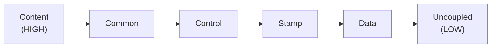

*Reference: Stevens, Myers and Constantine, Structured Design, IBM Systems Journal, 1974.*

---

### Q3. Strongest type of cohesion

> **Question:** Which type of cohesion is considered the strongest (best)?

`CO1` | `C1 Remember` | `1 Mark`

**Answer:** **Functional Cohesion**.

It occurs when all elements of a module work together to perform **one single, well-defined task**.

**Cohesion spectrum (from lowest to highest):**

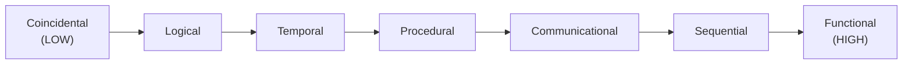

---

### Q4. Pipes and Filters

> **Question:** The command `ls -l | grep "Aug" | sort` follows a well-known architectural style. (a) Name the style. (b) State its main idea in one sentence.

`CO2` | `C1 Remember` | `2 Marks`

**(a) Style:** **Pipes and Filters** architecture.

**(b) Main idea:** Independent processing components called **filters** are connected by **pipes**. Each filter processes its input stream and passes its output to the next filter.

**Command breakdown**

| Part | Role | Function |
|---|---|---|
| `ls -l` | Filter 1 | Lists files in detailed format |
| `grep "Aug"` | Filter 2 | Keeps only lines containing "Aug" |
| `sort` | Filter 3 | Sorts the filtered lines |
| the pipe symbol | Pipe | Carries the output of one filter to the input of the next (ASCII data stream) |

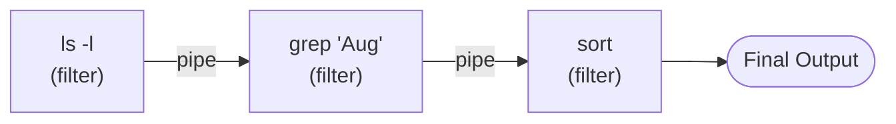

---

### Q5. Role of the controller in MVC

> **Question:** In the Model-View-Controller (MVC) style, what is the role of the controller?

`CO2` | `C1 Remember` | `1 Mark`

**Answer:** The **Controller takes user input, manipulates the Model, and causes the View to update appropriately.**

| Part | Role |
|---|---|
| **Model** | Represents information about the domain |
| **View** | Displays the model in the user interface |
| **Controller** | Handles user input, updates the Model, refreshes the View |

---

### Q6. CBO (Coupling Between Object classes)

> **Question:** (a) What does the CBO metric measure? (b) A class `Controller` has attributes `boolean alarm`, `Bell b` and `Light l`, and uses no other classes. State CBO(Controller).

`CO5` | `C1 Remember` | `2 Marks`

**(a) Definition:** CBO (Chidamber and Kemerer) measures the **number of other classes that a class uses (is coupled to)**.

$$CBO(A) = \text{number of classes used by } A$$

A high CBO means high coupling, which makes the class harder to maintain and test. Inheritance is typically not counted.

**(b) Calculation**

| Member | Type | Counted? |
|---|---|---|
| `alarm` | `boolean` (primitive) | No |
| `b` | `Bell` (class) | **Yes** |
| `l` | `Light` (class) | **Yes** |

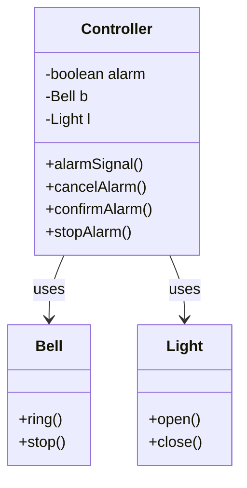

$$CBO(Controller) = 2$$

**Final Answer: CBO = 2**

---

### Q7. UI modalities

> **Question:** (a) Name the UI modality in which the user selects a command from a list of commands. (b) Name any two other UI modalities.

`CO5` | `C1 Remember` | `2 Marks`

**(a)** **Menu Selection.**

**(b)** Any two of the following:

| Modality | Description | Example |
|---|---|---|
| **Direct Manipulation** | User interacts with objects on screen using a pointing device or touch | Dragging and dropping a file |
| **Form Fill-in** | User fills in the fields of a form | Online registration form |

Other modalities: Question-Answer, Command Language, Natural Language.

---

## Section B: Three-Mark Questions (Q8 to Q12)

### Q8. Architectural design vs detailed design, and design rationale

> **Question:** Distinguish between Architectural Design and Detailed Design. Why is recording the rationale of design decisions important?

`CO1` | `C2 Understand` | `3 Marks`

**Difference**

| Basis | Architectural Design | Detailed Design |
|---|---|---|
| Also called | High-level / top-level design | Low-level design |
| Describes | How software is organized into components | The desired behavior of each component |
| Focus | Overall structure of the system | Internal logic of individual components |
| Level | Higher level of abstraction | Lower level, closer to implementation |

The input of the design process is the **requirements**. Its output is a set of **models and artifacts** that record the major decisions.

**Why recording design rationale is important**

1. It explains **why** a particular design was chosen.
2. It helps future developers understand the original decisions.
3. It supports **maintenance** and future changes without breaking the design intent.
4. It improves the **long-term maintainability** of the software product.

---

### Q9. Three UI design principles

> **Question:** Explain any three UI design principles with a brief reason for each.

`CO5` | `C2 Understand` | `3 Marks`

| Principle | Meaning | Reason | Example |
|---|---|---|---|
| **Learnability** | The software should be easy to learn so users can start working quickly | Reduces training time and effort | A simple search box on a search engine |
| **Consistency** | Comparable operations are activated in the same way | Users can predict system behavior, which reduces confusion | Ctrl+C is copy in every application |
| **Recoverability** | The interface lets users recover from errors | Reduces the cost of mistakes and builds user confidence | Undo button, Recycle Bin |

Other principles: User Familiarity, Minimal Surprise, User Guidance, User Diversity.

---

### Q10. Strategy pattern

> **Question:** Explain the intent of the Strategy pattern. State two benefits and one liability.

`CO3` | `C2 Understand` | `3 Marks`

**Intent:** **Define a family of algorithms, encapsulate each one, and make them interchangeable.** Strategy lets the algorithm **vary independently** from the clients that use it.

**Structure (example: route navigation)**

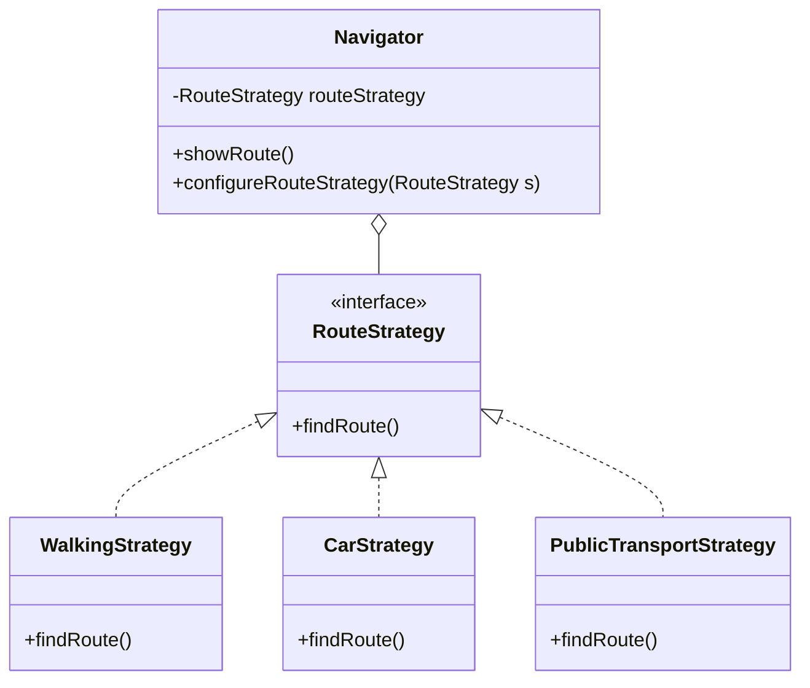

| Participant | Example | Role |
|---|---|---|
| **Context** | `Navigator` | Configured with a ConcreteStrategy; keeps a reference to a Strategy |
| **Strategy** | `RouteStrategy` | Common interface for all algorithms |
| **ConcreteStrategy** | `WalkingStrategy`, `CarStrategy` | Implement the algorithm using the Strategy interface |

**Benefits (any two)**

1. The Context is **isolated from the implementation details** of the algorithm.
2. **New strategies can be added without changing the Context.**

Other benefits: avoids complex conditionals; algorithms can be swapped at runtime.

**Liability:** **Strategies increase the number of objects** in the application. Designing a common interface for different algorithms may also be difficult.

---

### Q11. Page Controller vs Front Controller

> **Question:** Explain the difference between Page Controller and Front Controller. When is each suitable?

`CO4` | `C2 Understand` | `3 Marks`

| Basis | Page Controller | Front Controller |
|---|---|---|
| Definition | An object that handles a request for a **specific page or action** | A controller that handles **all requests** for a website |
| Structure | One controller per page or action | One central Web Handler plus a Command hierarchy |
| Request logic | Spread across many controllers | Centralized in one place |
| Suitable for | Sites where navigation logic is **simple** | Sites where navigation logic is **complex** |

**Page Controller structure**

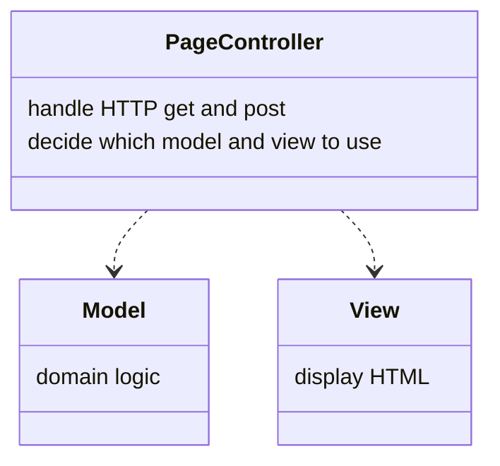

**Front Controller structure**

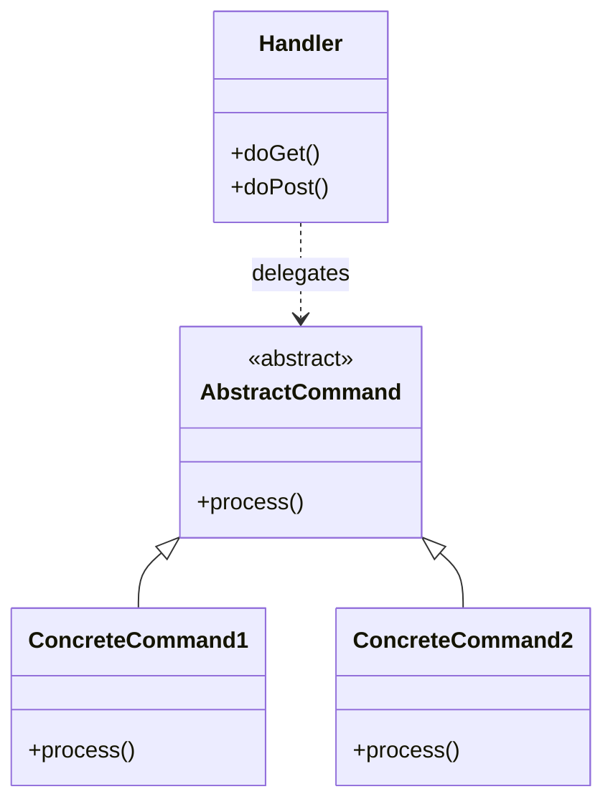

The Web Handler extracts just enough information from the URL and request to decide which action to start, then delegates to a **command** that carries out the action.

---

### Q12. WMC and LCOM

> **Question:** Explain what WMC and LCOM measure. Name two ways to measure method complexity for WMC.

`CO5` | `C2 Understand` | `3 Marks`

#### 1. WMC (Weighted Methods per Class)

WMC measures the **complexity of a class** as the sum of the complexities of its methods.

$$WMC(A) = \sum_{i=1}^{N} C_i$$

where $N$ is the number of methods and $C_i$ is the complexity of method $i$.

**Two ways to measure method complexity ($C_i$):**

| Way | How it is measured |
|---|---|
| **Lines of Code (LOC)** | Number of lines in the method |
| **McCabe complexity** | Number of conditions + 1 (each `if`, `for`, `while` counts as 1 condition) |

**Example (Controller class, McCabe version)**

| Method | Conditions | Complexity |
|---|---|---|
| `Controller()` constructor | 0 | 1 |
| `alarmSignal()` | 0 | 1 |
| `cancelAlarm()` | 0 | 1 |
| `confirmAlarm()` | 3 (`if alarm`, `if b`, `if l`) | 4 |
| `stopAlarm()` | 2 (`if b`, `if l`) | 3 |
| **WMC** | | **10** |

#### 2. LCOM (Lack of Cohesion of Methods)

LCOM measures **how weakly the methods of a class are related** through the attributes they use.

- **Q** = pairs of methods that **share** attributes
- **P** = pairs of methods that **do not share** attributes

$$LCOM = \begin{cases} |P| - |Q| & \text{if } |P| > |Q| \\ 0 & \text{otherwise} \end{cases}$$

| LCOM value | Meaning |
|---|---|
| **High** | Low cohesion (methods are unrelated) |
| **Low (0)** | High cohesion (methods work on shared data) |

**Example (Rectangle):** all three method pairs share attributes, so Q = 3, P = 0 and **LCOM = 0** (highly cohesive).

---

## Section C: Five-Mark Questions (Q13 to Q15)

### Q13. Software architecture and architectural styles

> **Question:** Define software architecture. Describe the layered, event-based and MVC architectural styles, stating the main idea of each.

`CO2` | `C2 Understand` | `5 Marks`

#### Definition of software architecture

A **software architecture** is the **set of structures needed to reason about the system**, comprising **software elements, relations among them, and properties of both** (Clements et al., 2010).

#### 1. Layered Architecture

**Main idea:** Components are organized into **layers**, and each layer depends only on the next layer below it.

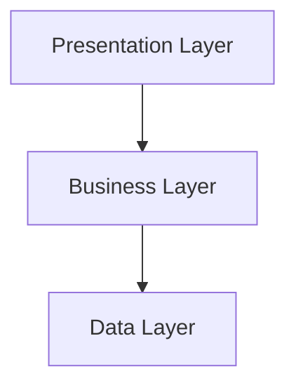

**Advantages:** separation of concerns, easier maintenance, better organization.

#### 2. Event-Based Architecture

**Main idea:** Components communicate through **events**. Producers publish events, and consumers who registered for them are notified through an event distribution mechanism, so components do not call each other directly.

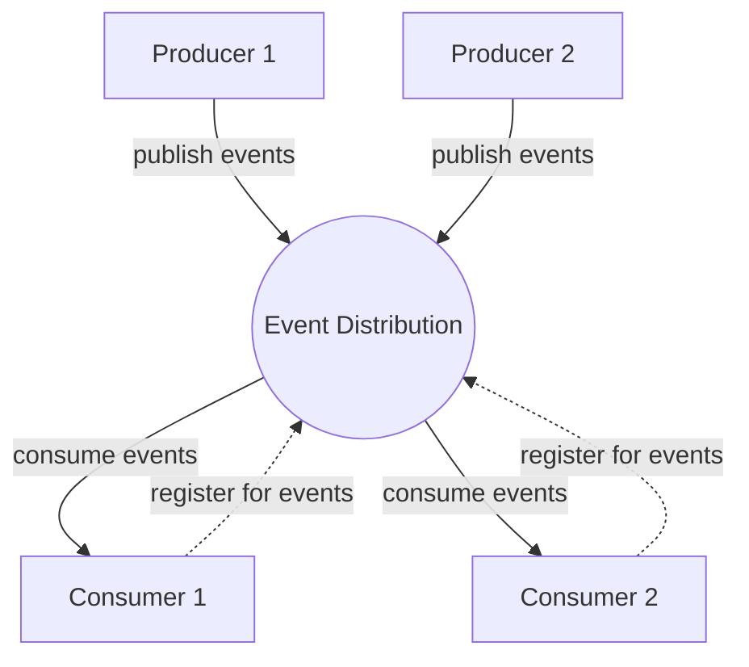

**Advantages:** loose coupling, flexible communication, supports asynchronous processing.
**Example:** GUI event handling (button clicks).

#### 3. Model-View-Controller (MVC)

**Main idea:** Separates the application into **Model** (domain information), **View** (display of the model) and **Controller** (takes user input, manipulates the model, updates the view). In this way the UI is a combination of the view and the controller.

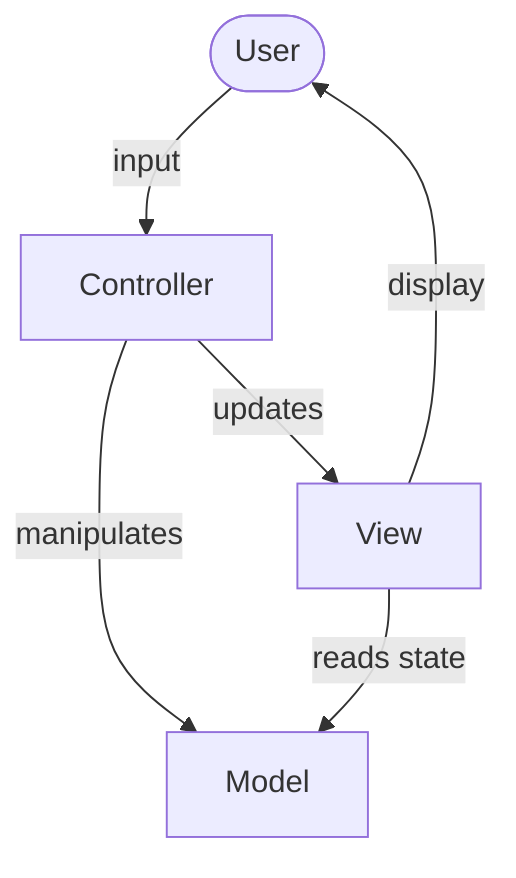

**Advantage:** separation of presentation from the model, which is one of the most important design principles in software.

#### Summary

| Style | Main Idea |
|---|---|
| **Layered** | Organizes components into layers; each layer depends only on the next layer |
| **Event-Based** | Components communicate through produced and consumed events |
| **MVC** | Separates data (Model), display (View) and input handling (Controller) |

---

### Q14. Facade pattern

> **Question:** Describe the Facade pattern. (a) Its intent (1 mark) (b) Its participants/structure (2 marks) (c) Its benefits and liabilities (2 marks)

`CO3` | `C2 Understand` | `5 Marks`

#### (a) Intent `[1 mark]`

**Provide a unified interface to a set of interfaces in a subsystem.** Facade defines a **higher-level interface** that makes the subsystem **easier to use**.

#### (b) Participants and structure `[2 marks]`

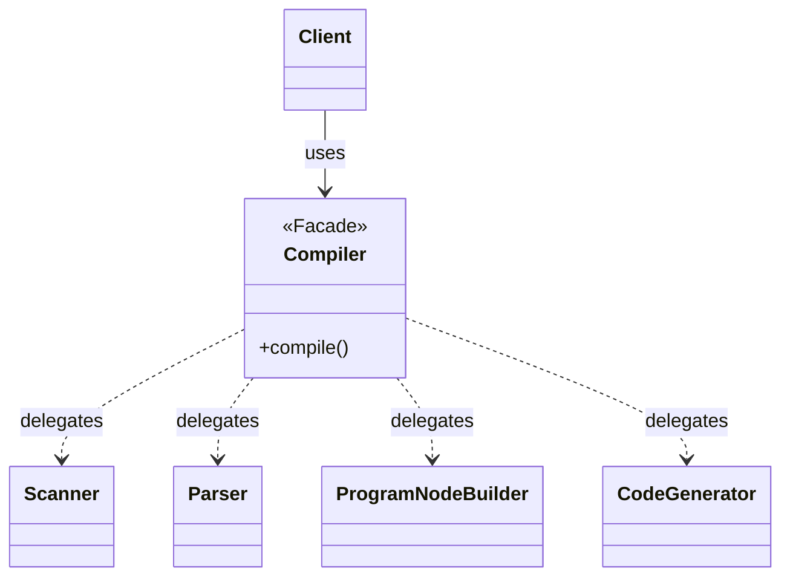

| Participant | Example | Responsibility |
|---|---|---|
| **Facade** | `Compiler` | Knows which subsystem classes handle a request and delegates client requests to them |
| **Subsystem classes** | `Scanner`, `Parser`, `ProgramNodeBuilder`, `CodeGenerator` | Implement the subsystem functionality; have **no knowledge of the facade** |
| **Client** | Application code | Uses the facade instead of many subsystem objects |

#### (c) Benefits and liabilities `[2 marks]`

**Benefits**

1. **Simplifies use of the subsystem.** It shields clients from subsystem components and reduces the number of objects clients deal with.
2. **Reduces coupling** between clients and subsystem classes.
3. **Flexible.** It does not prevent applications from using subsystem classes directly when needed.

**Liability:** The Facade can become a **God class** (an overly complex class that does too much).

---

### Q15. Domain Model, Service Layer and Data Mapper

> **Question:** Explain how Domain Model, Service Layer and Data Mapper fit into a layered enterprise application architecture. State the responsibility of each.

`CO4` | `C2 Understand` | `5 Marks`

In a layered enterprise application (Fowler), the layers are **Presentation**, **Domain** and **Data Source**. The three patterns separate business logic, application operations and database access.

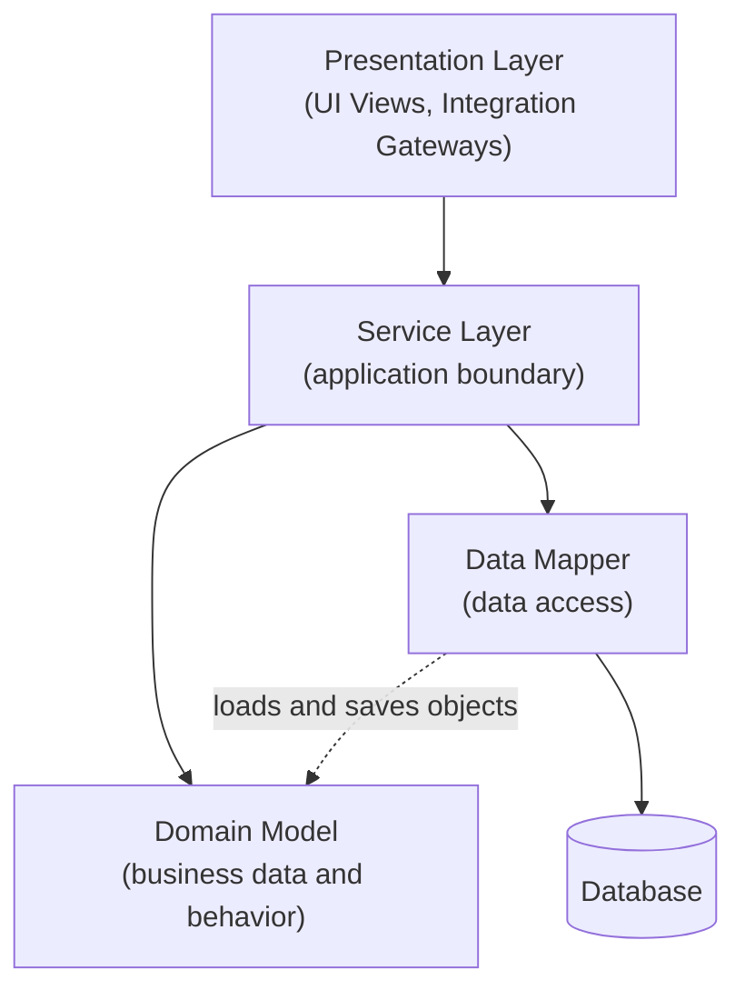

#### 1. Domain Model

An **object model of the domain that incorporates both behavior and data**. Each object represents a meaningful concept (for example, one object per table row).

- Holds business entities, relationships and **business rules**
- Best for **complex real-world business logic**
- *Example:* `Route`, `Driver`, `Stop`, `Service`

#### 2. Service Layer

**Defines the application's boundary** with a layer of services that establishes the available operations and **coordinates the application's response** in each operation.

- Provides a common set of operations to different clients (HTML, REST, others)
- **Avoids duplicating** interaction logic in every interface
- *Example:* a banking service with `deposit`, `withdraw`, `transfer`

#### 3. Data Mapper (also known as Repository or DAO)

A layer of mappers that **moves data between objects and the database while keeping them independent of each other** and of the mapper itself.

- In-memory objects **need not know a database exists**
- Separates persistence logic from business logic
- Fits well with the Domain Model

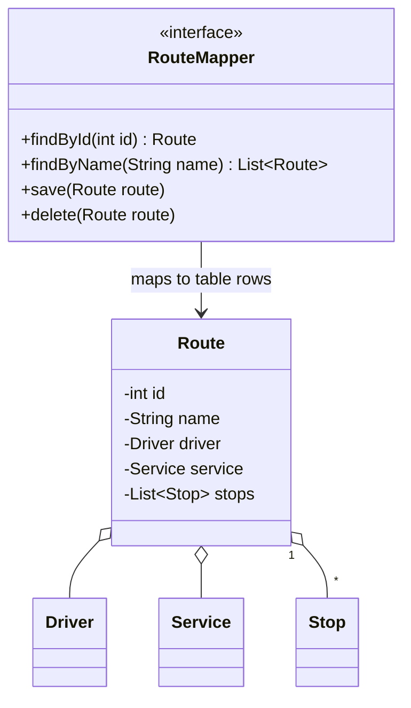

#### Summary of responsibilities

| Component | Main Responsibility |
|---|---|
| **Domain Model** | Represents business data, behavior and business rules |
| **Service Layer** | Defines and coordinates application-level operations |
| **Data Mapper** | Transfers data between domain objects and database tables |

**Conclusion:** The Domain Model holds the business logic, the Service Layer coordinates operations for all kinds of clients, and the Data Mapper handles database access. Together they improve maintainability, flexibility and separation of concerns.

---

# Part B: Assessment Summary

## 1. Question-wise Marks Distribution

| Question | Topic | Marks | CO | Bloom Level |
|---|---|---|---|---|
| Q1 | Architectural design | 1 | CO1 | C1 Remember |
| Q2 | Coupling | 1 | CO1 | C1 Remember |
| Q3 | Functional cohesion | 1 | CO1 | C1 Remember |
| Q4 | Pipes and Filters | 2 | CO2 | C1 Remember |
| Q5 | Controller in MVC | 1 | CO2 | C1 Remember |
| Q6 | CBO metric | 2 | CO5 | C1 Remember |
| Q7 | UI modalities | 2 | CO5 | C1 Remember |
| Q8 | Architectural vs detailed design | 3 | CO1 | C2 Understand |
| Q9 | UI design principles | 3 | CO5 | C2 Understand |
| Q10 | Strategy pattern | 3 | CO3 | C2 Understand |
| Q11 | Page vs Front Controller | 3 | CO4 | C2 Understand |
| Q12 | WMC and LCOM | 3 | CO5 | C2 Understand |
| Q13 | Architecture and styles | 5 | CO2 | C2 Understand |
| Q14 | Facade pattern | 5 | CO3 | C2 Understand |
| Q15 | Domain Model, Service Layer, Data Mapper | 5 | CO4 | C2 Understand |
| **Total** | **15 questions** | **40** | | |

## 2. CO-wise Marks Distribution

| Course Outcome | Questions | Total Marks | Percentage |
|---|---|---|---|
| CO1 | Q1, Q2, Q3, Q8 | 6 | 15% |
| CO2 | Q4, Q5, Q13 | 8 | 20% |
| CO3 | Q10, Q14 | 8 | 20% |
| CO4 | Q11, Q15 | 8 | 20% |
| CO5 | Q6, Q7, Q9, Q12 | 10 | 25% |
| **Total** | **15 questions** | **40** | **100%** |

## 3. Bloom's Taxonomy Mapping

| Cognitive Level | Questions | Marks | Percentage | Description |
|---|---|---|---|---|
| **C1 Remember** | Q1 to Q7 | 10 | 25% | Recall and identify fundamental software design concepts (Knowledge) |
| **C2 Understand** | Q8 to Q15 | 30 | 75% | Explain, describe, distinguish and interpret design concepts (Comprehension) |
| **Total** | 15 | 40 | 100% | |

## 4. Learning Outcome Coverage

All five Course Outcomes are covered in the question paper.

| CO | Coverage |
|---|---|
| CO1 | Fundamental software design concepts |
| CO2 | Software architecture and architectural styles |
| CO3 | GoF design patterns |
| CO4 | Enterprise application architecture patterns |
| CO5 | Software design quality metrics and UI design principles |

---

# Part C: Conclusion

This assignment presents the complete solutions to the OBE-based Software Engineering Design question paper prepared by **Obayet Rahman (IT24003)**.

- All **15 questions** are answered according to their marks, Course Outcomes and Bloom's Taxonomy levels.
- The solutions cover design fundamentals, architectural styles, GoF design patterns, enterprise application architecture, design quality metrics and UI design principles.
- Comparison tables, worked examples, mathematical expressions and **UML and architecture diagrams** are included for clarity.

This work demonstrates an understanding of Software Engineering Design concepts and their practical use in software development.

---

## References

1. Lecture Slides: `4-SoftEng-Design.pdf` (Software Design).
2. Anderson, L. W., and Krathwohl, D. R. (2001). *A Taxonomy for Learning, Teaching, and Assessing: A Revision of Bloom's Taxonomy of Educational Objectives.*
3. Gamma, E., Helm, R., Johnson, R., and Vlissides, J. (1995). *Design Patterns: Elements of Reusable Object-Oriented Software.*
4. Fowler, M. *Patterns of Enterprise Application Architecture.*
5. Clements, P., et al. (2010). *Documenting Software Architectures: Views and Beyond.*
6. Chidamber, S. R., and Kemerer, C. F. *A Metrics Suite for Object Oriented Design.*
7. McCabe, T. J. (1976). *A Complexity Measure.*
8. Stevens, W. P., Myers, G. J., and Constantine, L. L. (1974). *Structured Design.* IBM Systems Journal.

---

**Prepared By:** Samiul Islam
**Student ID:** IT24011
**Department:** Information and Communication Technology (ICT)
**University:** Mawlana Bhashani Science and Technology University (MBSTU)
