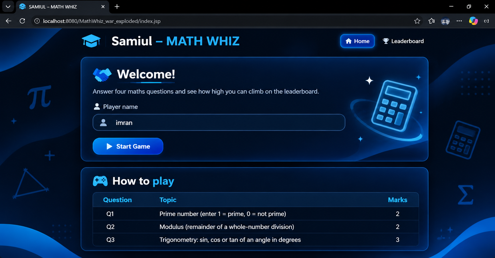
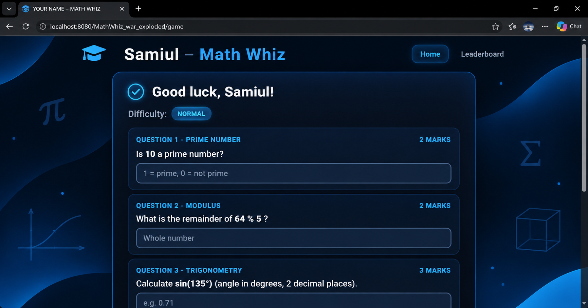
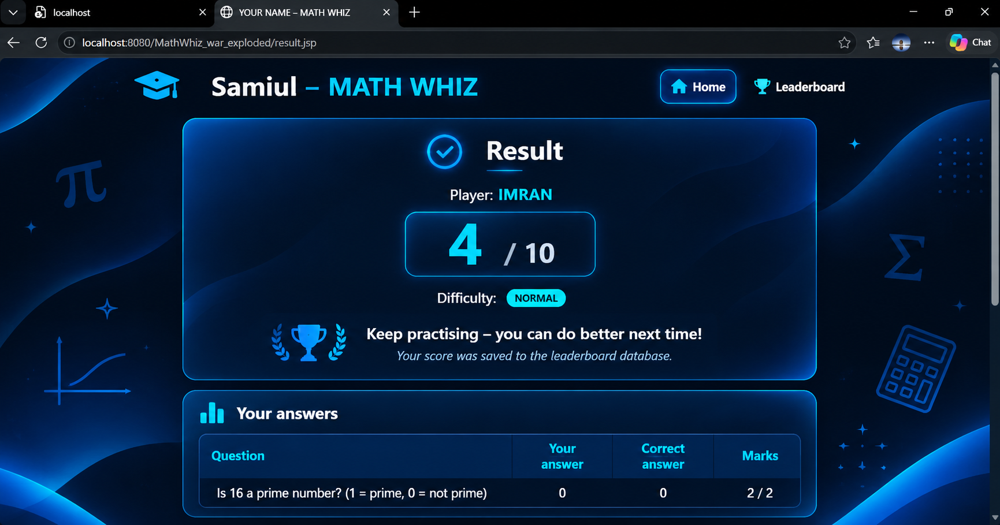
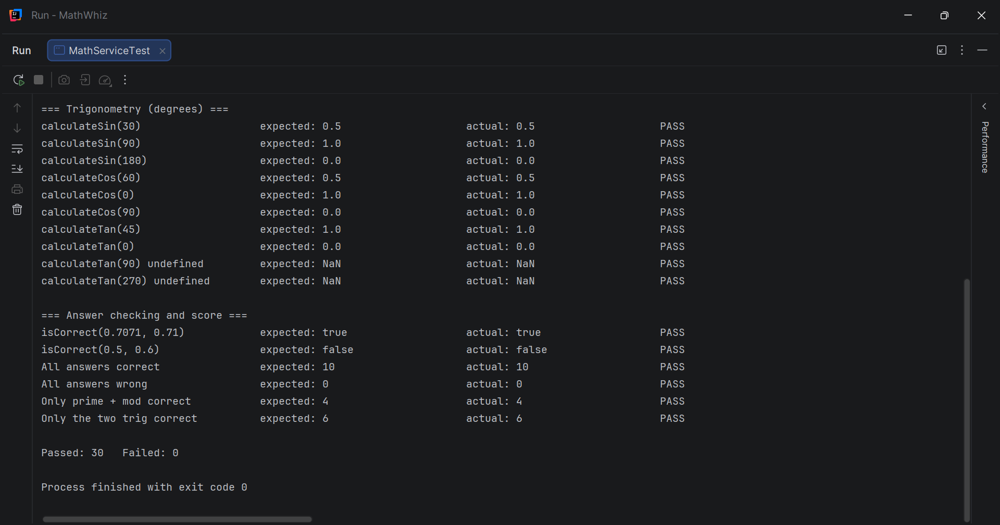

# 1. Samiul – MATH WHIZ

A web-based maths game built with **Java Servlet, JSP and JDBC**. The player answers four
questions (prime number, modulus and two trigonometry questions), gets a score out of 10,
and the result is saved in a MySQL database. A **Top 10 leaderboard** shows the best scores.

**Student:** Samiul Islam  |  **Student ID:** IT24011

## 2. Project Objectives

- Write reusable Java methods for maths (prime, modulus, sine, cosine, tangent).
- Use Servlet request/response processing with JSP pages.
- Connect to a database with JDBC and use `PreparedStatement` for INSERT and SELECT.
- Sort and show database records (Top 10 leaderboard).
- Document and submit a project on GitHub.

## 3. Technologies Used

| Technology | Use |
|------------|-----|
| Java (JDK 17 or newer) | Game logic and servlet |
| Jakarta Servlet 6.0 + JSP | Controller and pages |
| Apache Tomcat 10.1 | Application server |
| MySQL 8 + JDBC (MySQL Connector/J 8.4) | Saving scores |
| Maven | Build and dependencies |
| IntelliJ IDEA Ultimate | IDE |

## 4. Software Requirements

- JDK 17 or newer
- Apache Tomcat 10.1.x (Jakarta namespace, **not** Tomcat 9)
- MySQL Server 8.0
- IntelliJ IDEA Ultimate (or any IDE with Tomcat support) and Maven

## Project Structure

```
MathWhiz/
├── pom.xml
├── database/math_whiz_db.sql
├── src/main/java/
│   ├── controller/GameServlet.java     start game, check answers, leaderboard
│   ├── model/GameScore.java            one row of game_scores
│   ├── model/Quiz.java                 the four questions of one game
│   ├── model/QuestionResult.java       result of one question
│   ├── service/MathService.java        isPrime, calculateMod, calculateSin/Cos/Tan, score
│   ├── service/MathServiceTest.java    test runner for Task 09
│   ├── dao/ScoreDAO.java               JDBC INSERT and SELECT
│   └── util/Html.java                  escapes user text in pages
├── src/main/webapp/
│   ├── index.jsp  game.jsp  result.jsp  leaderboard.jsp
│   ├── css/style.css
│   └── WEB-INF/ (web.xml, jspf/header.jspf, jspf/footer.jspf)
└── README.md
```

## 5. Database Configuration

1. Start MySQL and run the SQL file (command line or MySQL Workbench / IntelliJ Database tool):

   ```
   mysql -u root -p < database/math_whiz_db.sql
   ```

2. Open `src/main/java/dao/ScoreDAO.java` and set your MySQL password:

   ```java
   private static final String USER = "root";
   private static final String PASSWORD = "YOUR_MYSQL_PASSWORD";
   ```

## 6. Database Creation SQL

```sql
CREATE DATABASE IF NOT EXISTS math_whiz_db;
USE math_whiz_db;

CREATE TABLE IF NOT EXISTS game_scores (
    id          INT AUTO_INCREMENT PRIMARY KEY,
    player_name VARCHAR(100) NOT NULL,
    score       INT          NOT NULL,
    difficulty  VARCHAR(20)  NOT NULL DEFAULT 'NORMAL',
    played_at   TIMESTAMP    NOT NULL DEFAULT CURRENT_TIMESTAMP
);
```

Leaderboard query (highest score first, earlier time first when scores are equal):

```sql
SELECT * FROM game_scores ORDER BY score DESC, played_at ASC LIMIT 10;
```

## 7. Steps to Run the Application

1. Open IntelliJ IDEA and choose **File > Open**, then select the `MathWhiz` folder (the one with `pom.xml`). Wait for Maven to load.
2. Create the database (see above) and set the password in `ScoreDAO.java`.
3. Go to **Run > Edit Configurations > + > Tomcat Server > Local**. Click **Configure...** and select your Tomcat 10.1 folder.
4. On the **Deployment** tab click **+ > Artifact** and choose `MathWhiz:war exploded`.
5. Set the **URL** on the **Server** tab to `http://localhost:8080/MathWhiz_war_exploded/` and click **Run**.
6. The welcome page opens in the browser.

## 8. Game Rules and Scoring

| Question | Area | Marks | How it works |
|----------|------|-------|--------------|
| Q1 | Prime number | 2 | Enter **1** if the number is prime, **0** if not. Numbers below 2 are not prime. |
| Q2 | Modulus | 2 | Whole-number remainder `a % b`. The divisor is never zero. |
| Q3 | Trigonometry | 3 | sin, cos or tan of an angle in degrees. |
| Q4 | Trigonometry | 3 | A different function from Q3. |
| **Total** | | **10** | |

- Questions are random. The correct answers are **calculated by the Java methods** in `MathService`, never stored.
- Angles are entered in degrees and converted to radians with `Math.toRadians` before `Math.sin`, `Math.cos` or `Math.tan`.
- Decimal answers are accepted when they are within **0.01** of the real value (so 0.71 is accepted for sin(45°) = 0.7071).
- Tangent is undefined at 90° and 270°; `calculateTan` returns `NaN` there and those angles are never asked.
- Difficulty is **NORMAL** for every question and is saved in the database with the player name, score and date/time.

### Java methods

```java
public static int    isPrime(int number)          // 1 = prime, 0 = not prime
public static int    calculateMod(int a, int b)   // a % b, throws ArithmeticException if b == 0
public static double calculateSin(double degree)
public static double calculateCos(double degree)
public static double calculateTan(double degree)
```

### Score calculation

```java
int totalScore = 0;
if (primeCorrect) totalScore += 2;
if (modCorrect)   totalScore += 2;
if (trig1Correct) totalScore += 3;
if (trig2Correct) totalScore += 3;
```

## Testing 

Run `service/MathServiceTest.java` (its `main` method) to check the functions.

| Test case | Expected result | Result |
|-----------|-----------------|--------|
| Prime input: 7 | 1 | PASS |
| Prime input: 8 | 0 | PASS |
| Prime input: 1 | 0 | PASS |
| Modulus: 17 % 5 | 2 | PASS |
| Sine: 30° | 0.5 | PASS |
| Cosine: 60° | 0.5 | PASS |
| Tangent: 45° | 1.0 | PASS |
| Divisor: 0 | Validation error | PASS |
| All answers correct | 10 marks | PASS |
| Incorrect answers | Marks not awarded | PASS |

The game page also validates the input: an empty name, a prime answer other than 0/1, a decimal
modulus answer or text in a number box shows an error message and the game continues.

## 9. Application Screenshots

### Welcome Page


### Game Page


### Result Page



### Test Output


## Author

Samiul Islam – Student ID: IT24011
